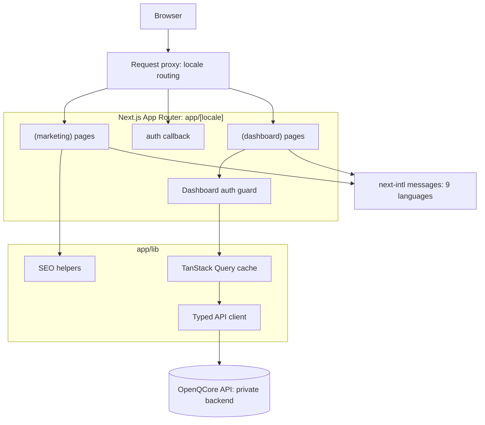

# OpenQCore Web

**The control dashboard and marketing site for OpenQCore: a multilingual, workspace-aware Next.js application.**


OpenQCore Web is the front end of the [OpenQCore](https://openqcore.com) AI platform. It has two halves: a public marketing site, and an authenticated dashboard where teams manage agents, knowledge bases, API keys, members, usage, and billing. It talks to the OpenQCore backend API, whose source is private. An architecture overview of the platform is in [openqcore-platform-overview](https://github.com/Open-QCore/openqcore-platform-overview).

> **Status:** final pre-launch development.

<!-- Add screenshots here, then delete this comment:


-->

## At a glance

| | |
|---|---|
| Size | ~78K lines of TypeScript across 405 TS/TSX files |
| Routes | 99 pages, split between the marketing site and the dashboard |
| Languages | 9, with full right-to-left support for Arabic |
| Framework | Next.js 16 (App Router), React 19, TypeScript 5 |
| Styling | Tailwind CSS 4, Framer Motion |
| Data layer | TanStack Query with a typed API client (51 modules) |
| Internationalisation | next-intl, one JSON file per language, translation script |

## What is in it

**Dashboard** (authenticated):
- Workspaces and a workspace switcher, with personal and workspace scopes
- Agents with model selection and versioning
- Knowledge bases for retrieval
- API keys, members and invitations
- Usage analytics (Recharts), wallet balance, and usage tiers
- Upgrade and downgrade flows for personal and workspace plans
- Storage and compute resources
- Notifications, command palette, and a collapsible sidebar

**Marketing site** (public):
- Platform pages: models, enterprise, analytics, studio, agents
- Solutions pages, including a government solutions page
- Changelog, SEO metadata, and industry imagery
- Every page translated into all 9 languages

## Architecture



*Conceptual diagram, not a deployment specification.*

## Design decisions

**Locale-first routing.** Every route lives under `app/[locale]`, so all 9 languages share one route tree. Arabic switches the layout to right-to-left, and components use logical CSS properties (`start` and `end` rather than `left` and `right`), so one component works in both directions.

**One session, one guard.** The dashboard sits behind a single auth guard. Session expiry is handled centrally in the API client, which shows a dedicated notice instead of letting individual screens fail one by one.

**Clear scope semantics.** Personal and workspace scopes are visually distinct throughout the dashboard (amber for personal, red for workspace), so users always know whose wallet and data an action affects.

**Loading and empty states are explicit.** The workspace switcher distinguishes "still loading" from "no workspaces yet", and a zero-workspace account gets a create prompt instead of an empty screen.

**Server state in one place.** Backend data goes through TanStack Query, so caching, invalidation, and loading states are consistent across screens.

**Dark-only interface.** One carefully tuned theme rather than two half-tuned ones.

## Tech stack

| Concern | Choice |
|---|---|
| Framework | Next.js 16, React 19 |
| Language | TypeScript |
| Styling | Tailwind CSS 4, clsx, tailwind-merge |
| Data fetching | TanStack Query, Axios |
| Internationalisation | next-intl |
| Charts | Recharts |
| Animation | Framer Motion |
| UI primitives | Radix UI (Popover), cmdk, lucide-react |

## Project structure

```
app/
  [locale]/
    (marketing)/     public pages
    (dashboard)/     authenticated dashboard
    auth/            sign-in callback
    changelog/
  lib/
    api/             typed API client modules
    seo/             metadata helpers
    constants/
    runtime/
i18n/                locale configuration
messages/            one JSON file per language
scripts/             translation tooling
public/images/       marketing imagery
```

## Getting started

Requirements: Node.js 20 or newer.

```bash
npm install
npm run dev
```

The app runs at [http://localhost:3000](http://localhost:3000).

The dashboard needs the OpenQCore API, which is private, so dashboard routes require a reachable backend. The marketing site renders without it.

| Script | Purpose |
|---|---|
| `npm run dev` | Development server |
| `npm run build` | Production build |
| `npm run start` | Serve the production build |
| `npm run lint` | ESLint |
| `npm run i18n` | Translation tooling for the language files |

## Roadmap

- Automated tests for the API client and the dashboard auth flow
- Continuous integration for lint, type check, and build
- Published component and screenshot gallery

## Related

- [OpenQCore platform overview](https://github.com/Open-QCore/openqcore-platform-overview): backend architecture and research
- [openqcore.com](https://openqcore.com): the product site

## Author

**Mohamed Eid**, architect and lead engineer. [github.com/Mo-eid200](https://github.com/Mo-eid200)

---

&copy; 2026 OpenQCore. Source is public for review; all rights reserved.
